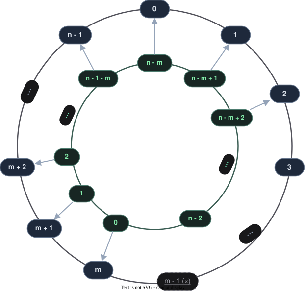

# 01-第一周
## Day2

### [DP4 最小花费爬楼梯](https://www.nowcoder.com/practice/9b969a3ec20149e3b870b256ad40844e?tpId=230&tqId=39751&ru=/exam/oj)

这个是涉及到了动态规划。

思路：
1. 设计一个 `dp` 表，**`dp[i]` 是表示到达 `i` 位置的最小的花费**
2. `dp[i]` 位置计算：
	1. 根据题意，它**最多跳两次**，因此这个位置上的值最多就只会在 `dp[i - 1] + cost[i - 1]` 和 `dp[i - 2] + cost[i - 2]` 的里面算
	2. 那么只需要判断一下**它们两个的最小值**，就可以算出来 `dp[i]` 的值了
	3. 由于需要先知道 `dp[i - 1]` 和 `dp[i - 2]` 的值，因此需要**从左往右计算**


```Java
public static void main(String[] args) {
	Scanner in = new Scanner(System.in);
	// 注意 hasNext 和 hasNextLine 的区别

	while (in.hasNextInt()) { // 注意 while 处理多个 case
		int n = in.nextInt();
		if (n <= 2) {
			if (n == 2) System.out.println(Math.min(in.nextInt(), in.nextInt()));
			else System.out.println(in.nextInt());
			return;
		}
		int[] cost = new int[n];
		for (int i = 0; i < n; i++) {
			cost[i] = in.nextInt();
		}

		int[] dp = new int[n + 1]; // dp[i] 是表示到达 i 位置的最小的花费

		for (int i = 2; i < n + 1; i++) {
			dp[i] = Math.min(dp[i - 2] + cost[i - 2], dp[i - 1] + cost[i - 1]);
		}
		// print(cost);
		// print(dp);

		System.out.println(dp[n]);
	}
}

static void print(int[] arr) {
	for (int x : arr) {
		System.out.print(x + " ");
	}
	System.out.println();
}
```

### [数组中两个字符串的最小距离](https://www.nowcoder.com/questionTerminal/2c6a0a8e1d20492f92941400036e0890)

思路：
1. 用两个变量来分别记录两个字符串的**最新的一个下标**
2. 在**匹配到其中一个字符串**的时
	1. 判断一**下另一个下标是否已经有记录**了，如果有，那么就可以更新一下最终的结果
	2. 然后更新一下对应的变量，记录当前的下标

```Java
public static void main(String[] args) throws Exception {
	// 使用 BufferedReader 可以加快读取的速度
	BufferedReader in = new BufferedReader(new InputStreamReader(System.in));
	int n = Integer.valueOf(in.readLine());
	String[] t = in.readLine().split(" ");
	String str1 = t[0], str2 = t[1];
	
	// 用 index1, index2 来分别记录 str1, str2 的最新的下标
	int index1 = -1, index2 = -1;
	int result = Integer.MAX_VALUE;
	for (int i = 0; i < n; i++) {
		String tmp = in.readLine();
		if (str1.equals(tmp)) { // 满足对应的条件
			index1 = i; // 更新对应的下标
			if (index2 != -1) result = Math.min(result, i - index2); // 更新结果
		} else if (str2.equals(tmp)) {
			index2 = i;
			if (index1 != -1) result = Math.min(result, i - index1);
		}
	}

	// 最后的结果判断一下，如果有还是一样的值，那么就不需要修改了
	System.out.println(result == Integer.MAX_VALUE ? -1 : result);

}
```

## Day3
### [dd爱框框](https://ac.nowcoder.com/acm/problem/221681)

思路很简单，由于里面的**数都是正数**，使用双指针就可以解决了。

不过需要注意到的细节是：**要考虑到数据量过大导致 IO 时间过长的情况。**

解决方法：使用缓存，详情参考 [Java 快速 IO](<./00-导读.md#Java 快速 IO>)

```Java
import java.util.*;
import java.io.*;

public class Main {
    static Read in = new Read();
    
    public static void main(String[] args) throws Exception {
        
        // 注意 hasNext 和 hasNextLine 的区别
        
        int n = in.nextInt(), x = in.nextInt();

        int[] nums = new int[n];

        for (int i = 0; i < n; i++) {
            nums[i] = in.nextInt();
        }

        // sum = nums[left, right)
        int left = 0, right = 0, sum = 0, resultLeft = 0, resultRight = n;
        while (right < n) {
            if (sum < x) sum += nums[right++];
            else {
                if (right - left < resultRight - resultLeft) {
                    resultLeft = left;
                    resultRight = right;
                }
                sum -= nums[left++];
            }
        }

        System.out.println((resultLeft + 1) + " " + resultRight);
    }
}

class Read {
    StringTokenizer st = new StringTokenizer("");
    BufferedReader br = new BufferedReader(new InputStreamReader(System.in));
    
    String next() throws Exception {
        if (!st.hasMoreTokens()) {
            st = new StringTokenizer(br.readLine());
        }
        return st.nextToken();
    }
    
    String nextLine() throws Exception {
        return br.readLine();
    }
    
    int nextInt() throws Exception {
        return Integer.parseInt(next());
    }
}

```


## Day5

### [NC398 腐烂的苹果](https://www.nowcoder.com/practice/54ab9865ce7a45968b126d6968a77f34?tpId=196&tqId=40529&ru=/exam/oj)
这个是使用 BFS(广度优先)，因为它是每一次都只扩散相邻的，但是是所有的节点同时扩散

思路：
1. 先遍历一次数组，**把腐烂的苹果添加到队列中**
2. 遍历队列，**看看它还能不能继续扩散**，如果可以，那么就把相关的地址添加到临时队列中
3. 如果在遍历完队列中的所有的元素时，临时队列为空，那么就可以停止循环了，如果不为空，那么把临时队列中的元素添加到队列中，继续遍历，**同时把层数加 1**
4. 在遍历完后，**还需要再判断一下原理的数组还有没有正常的苹果**，如果有，那么返回 1, 如果没有，那么就返回对应的层数
```Java
import java.util.*;

public class Solution {
    class Node {
        public int i;
        public int j;
        public Node(int i, int j) {
            this.i = i;
            this.j = j;
        }
        public String toString() {
            return "[i = " + i + ", j = " + j + "]";
        }
    }
    /**
     * 代码中的类名、方法名、参数名已经指定，请勿修改，直接返回方法规定的值即可
     *
     * 
     * @param grid int整型ArrayList<ArrayList<>> 
     * @return int整型
     */
    public int rotApple (ArrayList<ArrayList<Integer>> grid) {
        Queue<Node> queue = new LinkedList<>();
        int n1 = grid.size(), n2 = grid.get(0).size();

        for (int i = 0; i < n1; i++) {
            // System.out.println(grid.get(i));
            for (int j = 0; j < n2; j++) {
                if (grid.get(i).get(j) == 2) queue.offer(new Node(i, j));
            }
        }

        int result = -1;
        while (!queue.isEmpty()) {
            System.out.println(queue);
            Queue<Node> tmp = new LinkedList<>();
            while (!queue.isEmpty()) {
                Node tmpNode = queue.poll();
                int i = tmpNode.i, j = tmpNode.j;
                if (i + 1 < n1 && grid.get(i + 1).get(j) == 1) {
                    grid.get(i + 1).set(j, 2);
                    tmp.offer(new Node(i + 1, j));
                }
                if (i - 1 >= 0 && grid.get(i - 1).get(j) == 1) {
                    grid.get(i - 1).set(j, 2);
                    tmp.offer(new Node(i - 1, j));
                }
                if (j + 1 < n2 && grid.get(i).get(j + 1) == 1) {
                    grid.get(i).set(j + 1, 2);
                    tmp.offer(new Node(i, j + 1));
                }
                if (j - 1 >= 0 && grid.get(i).get(j - 1) == 1) {
                    grid.get(i).set(j - 1, 2);
                    tmp.offer(new Node(i, j - 1));
                }
            }
            queue = tmp;
            result++;
        }

        for (int i = 0; i < n1; i++) {
            for (int j = 0; j < n2; j++) {
                if (grid.get(i).get(j) == 1) return -1;
            }
        }
        return result;
    }
}
```

### [JZ62 孩子们的游戏](https://www.nowcoder.com/practice/f78a359491e64a50bce2d89cff857eb6?tpId=13&tqId=11199&ru=/exam/oj)
这个可以使用动态规划来解决：
1. 定义：`dp[i]`: 有 i 个孩子最终胜利孩子的下标
2. `dp[0]` 显然就是 0，既胜利者是它自己
3. **递推公式**：
	   
	1. 第 i 个小朋友（起始坐标为 0）经过一轮筛选后，把下标为 m - 1 的小朋友给淘汰了。
	2. **而原来下标为 m 的小朋友成为了第一个，因此在新的一轮中，原来下标为 m 会变为下标为 0**, 记原来的下标为 $i_{1}$ 新的下标为 $i_{2}$ , 
	3. 那么就存在这样的映射关系: $i_{2} = i_{1} + m$
	4. 考虑到 m 过长的情况，还要取模，因此递推公式为 $i_{2} = (i_{1} + m) \pmod{len}$ 
```Java
public int LastRemaining_Solution (int n, int m) {
	// 使用动态规划来解决 

	// 1. 定义 dp[i] 的意义: i + 1 个小孩的最终胜利的孩子下标
	int[] dp = new int[n];
	dp[0] = 0; // 只有一个小孩的情况，胜利者就是他自己
	
	// 2. 状态转移方程
	for (int i = 1; i < n; i++) {
		dp[i] = (dp[i - 1] + m) % (i + 1);
	}
	return dp[n - 1];
}
```