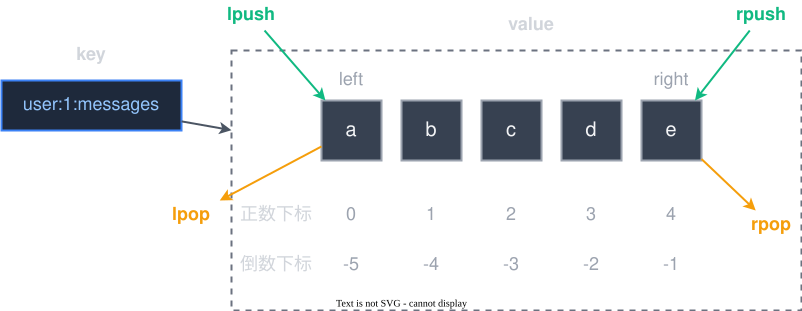

# 04-list类型

list 类型底层的数据机构是双端队列，这个在头插/尾插/头删/尾删都比较方便高效

## 命令
### `lpush`，`rpush` 和  `lrange`
`lpush` 是头插，`rpush` 是尾插，同理它们都是可以**批量添加**的。`lrange` 是**批量获取**链表元素，它下标的范围和 getrange 一样，也是**支持负数**的

### `lpushx` 和 `rpushx`
`x` 表示 `exists`，表示如果 `key` 存在则执行。

那么 **`lpushx/rpushx` 就是如果 `key` 存在则头插/尾插**

### `lpop` 和 `rpop`
**`lpop` 是头删，`rpop` 是尾删。**

在 **Redis 6.2 版本后**，`lpop` 和 `rpop` 才**支持批量删除**，如果是 Redis 5.xx 那是不支持批量删除的

### `lindex` 和 `linsert`
`lindex` 是获取到指定下标的值，当然也是支持负数的

`linsert` 是根据元素值插入数据，可以插入这个元素的前面或后面
> 有没有插入指定下标的方法呢？貌似没有，因为这个底层的数据结构是链表而不是数组

### `llen`
查询指定链表的元素个数

### `lrem` 和 `ltrim`
`lrem` 它是用来删除元素，根据 `count` 来删除元素个数

- `count < 0`: **从后往前**删除 `count` 个
- `count = 0`: **删除全部**
- `count > 0`: **从前往后**删除 `count` 个

`ltrim` 是去除两边的值，只保留中间的内容
### `lset`
设置指定值的内容，但是不能越界

### `brpop`, `blpop`
**b 是这 block，表示是阻塞**。一般在把 `Redis` 中的 list 作为消息队列的时候才会使用
> 这两个命令仅仅了解即可，
> 
> 因为**如果要使用消息队列，可以使用像 `RabbitMQ` 这样更好的组件，而在 `Redis` 中，`stream` 的功能也是比 `list` 更加强大**，因此这两个命令的地位只会越来越低 

## 应用场景
### 存储 id
比如在存储 学生-班级 信息的时候，**班级里面存储的就可以是学生 id**, 通过链表的方式来存储
> 班级的 key 可以是 class:1, class:2 等之类的，**里面存储学生 id**
> 
> 而学生的 key 可以是 stu:1, stu:2 等之类的，这样就可以通过班级 id 查询学生信息了

### 消息队列
虽然消息队列不是 `list` 的优势，但是**如果仅仅是像简单的使用一下，而又不想新引入一个组件**，那么 `Redis` 的 `list` 类型就相对比较适合了

### 分页查询
`list` 还可以支持分页查询，但是需要注意几个点
- 如果 **`list` 的长度比较长**，那么需要就需要把一个大的 `list` 拆分为若干个小的 `list`，这个会提高执行的效率，但是也会提高代码的复杂性，**需要根据具体的业务来决定**
- 由于 `list` 里面存储的是 id，因此在查询的时候会有比较多 `Redis` 命令，如果不处理，会有比较大的网络开销。**可以通过管道（流水线），把多条命令塞进一个网络请求中，从而减少网络开销**

但是 `Redis` 是不适合处理**有条件**的分页查询，比如根据名称查询