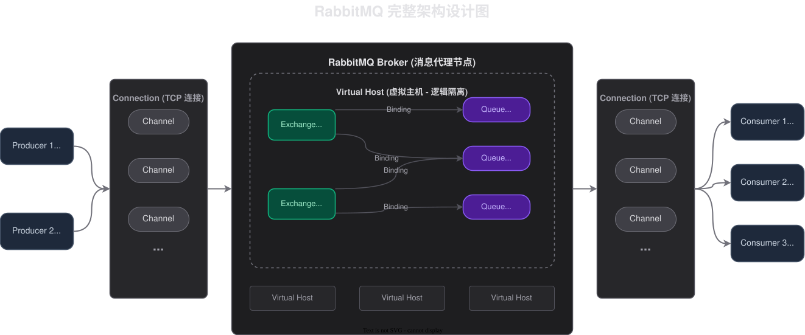
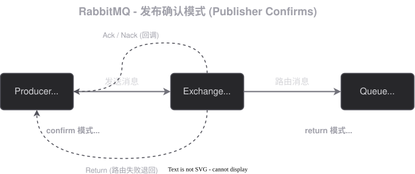

# 02-RabbitMQ高级特性

## 消息确认

这里的**消息确认是队列到消费者之间的确认**，而不是生产者到队列之间的确认。生产者到队列之间的确认叫作发布确认

### 机制
由于接收到消息只有两种状态：**正常接收和异常接收**。因此消息确认针对这两个有不同的处理结果
- `ACK`: 告诉队列已经正常接收到了，让队列可以把原本的消息给丢弃了
- `NACK`: 告诉队列消息接收/处理异常，可以通过传入相关的参数控制重新发送相关的参数
> 这些都是**手动确认的情况下才可以实现**，如果是自动确认，那么就没有相关的配置了

但是在 `Java` 中是分为三个机制：
- `NONE`: 这个是表示**什么都不操作**，接收到就直接丢弃
- `AUTO`: 这个是**没有异常就是自动 `ACK`**，如果**有异常，那么就自动发送 `NACK`**
- `MANUAL`: 手动操作，无论是否有异常，都**由程序员设定**

> `Java` 这三个机制是站在自己的视角下面的，
> - `none` 不操作 -> 那就只能让 `RabbitMQ` 自动确认了 
> - `auto` 自动 -> 有异常重新发送，没异常自动执行其他逻辑 
> - `manual` 手动 -> 把控制权交还给程序员

## 持久化

在消息的传输过程中，可能会在这三个地方出现问题：
1.  在生产者到 `RabbitMQ` 的服务端
2.  `RabbitMQ` 服务端
3.  `RabbitMQ` 服务端到消费者

在 1 和 3 这两个情况，可以使用**发布确认和消息确认**这两个机制来保证传输的可靠性。而第 2 个这个情况，就是要使用**持久化**来保障了

持久化还可以分为三块：**交换机持久化，队列持久化和消息持久化。**
- 消息持久化：就是把消息设置为持久化，**如果想要消息持久化，那么队列也必须要持久化**
> 交换机持久化和队列持久化这里就不说了，因为之前的就已经设置过了

## 发布确认

发布确认是分为 **`confirm` 模式**和 **`return` 模式**
- `confirm`: 处理生产者到交换机之间的关系
- `return`: 处理交换机到队列之间的关系

## 重试机制
如果是**网络波动**导致的问题，**采用重试是很不错的**一个解决方案，但是如果是**代码导致**的问题，那么**多次重复是无法解决问题**的，因此配置重试的次数/时间是一个很有必要的选择了

## TTL
`RabbitMQ` 设置 `TTL` 有两个地方可以设置，设置**消息的 `TTL` 和设置队列的 `TTL`**, 消息的 `TTL` 是仅仅针对这一个消息，而队列是针对所有的进入这个队列的消息。

**一个消息的 `TTL` 是取决于队列的 `TTL` 和消息本身的 `TTL` 的较小值**

### 回收机制
**队列的 `TTL`** 是可以通过**判断队首元素来判断当前是否是消息是否过期**，但是消息的 `TTL` 是不能判断的，如果每一次判断都遍历一次队列，那么性能就太低了。

**消息的 `TTL`** 是在**要被消费之前才会判断**，因此这就可能会产生已经过期但依然占用资源的内容（比如第一次发送的 TTL 为 30s 第二次发送 5s）