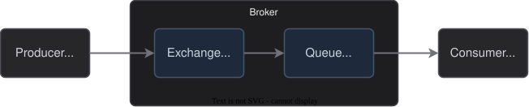
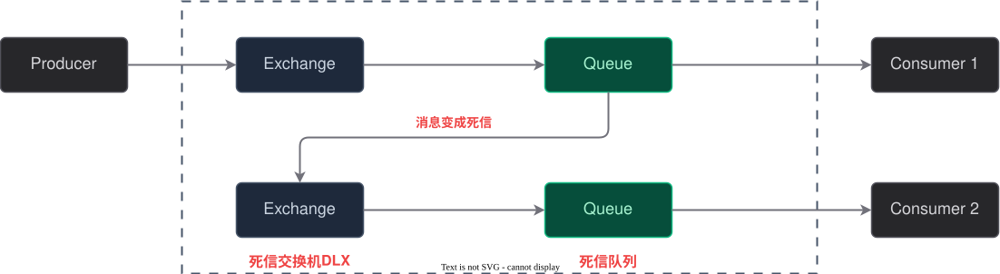

# 90-面试题

## RabbitMQ 如何保证可靠性？
这个一般不会这样问，它是一般会这样问：消息丢失了怎么办？MQ 可靠性怎么保证的？这样之类的话

||

它可能在这几个地方出现问题：生产者到交换机，交换机到队列，队列到消费者和 `Broker`

因此就要从这几个方面入手：

|    问题    |            解决措施             |
| :------: | :-------------------------: |
| 生产者到交换机  | 采用**发布确认机制**中的 `confirm` 模式 |
|  交换机到队列  | 采用**发布确认机制**中的 `return` 模式  |
|  队列到消费者  |        采用**消息确认机制**         |
| `Broker` |           **持久化**           |
详细的内容去对应的章节里面查询，这里就不讲述了
||

## 请给我介绍一下什么是死信

相关的面试题还有：死信的应用场景，死信发生的条件等

||

死信是由于种种原因，导致一些消息始终没有被消费掉，这些消息就是死信

死信是经常出现在这样的**场景**：
- 消息的 `TTL` 过期
- 消息太多，超过了队列的最大长度
- 消息被消费了，但是是 `NACK`

死信可以**配合 `TTL` 处理支付**这样的业务场景
1. 支付订单正常发出，**设置了一个过期时间(TTL)**
2. 当用户**超过了指定的过期时间**还没有付款，那么就把它放入死信队列
3. 处理死信队列的**消费者就可以把订单的状况设置为“已取消”**

还可以**配合 `NACK` 来处理异常的工单**：当出现消息多次异常消费的情况，就可以把消息放入死信队列，然后交给人工处理
||