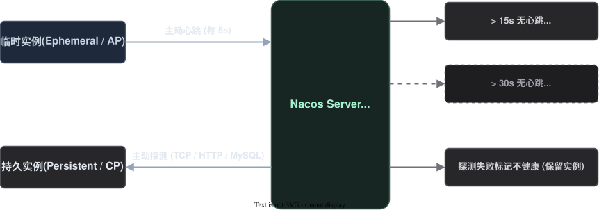

# 01-注册中心

## 概念
### 注册中心


- `注册中心`：**存储并管理**服务提供者提供的配置信息
- `服务提供者`：**提供**相关的配置内容
- `服务消费者`：从注册中心**获取**服务提供者提供
### CAP

- `C(Consistency)`: 一致性，它分为强一致性和弱一致性
	- `强一致性`：**任何时候**，同一个请求，**请求到的数据都是一样的**
	- `弱一致性`：**随着时间的推移**，同一个请求最终的请求结果是一样的
	> 以 `MySQL` 为例，`MySQL` 可以分为主库和从库，在修改数据的时候，需要有一定时间来主从同步。
	> - 如果是强一致性，那就**必须等待同步**完后才能访问
	> - 如果是弱一致性，那么**不需要等待同步**，但是可能会出现数据不一致的问题
- `A(Availability)`: 可用性，无论请求的结果是否正确，请求是否会有响应。一般它是和一致性是互斥的，两个只能选一个。
- `P(Partition Tolerance)`: 分区容错性，一个节点挂了，其他的节点能不能顶上，使得**整个系统的访问没有出现太大的问题**。在分布式架构下，这个是必须的

> **上诉的内容是在分布式架构下的说法，如果是单机架构，那就不一样的**


## 实现
### Nacos
#### 负载均衡
Nacos 负载均衡分为 **下线，权重配置和同集群优先访问**

##### 下线
当**某个服务出现问题**的时候，如果需要把它修复，那么是要花费比较长的时间的，那么就可以**采用下线**的功能，把有问题的服务先下线，在慢慢处理
> 在企业中，如果发现了问题，第一时间不是修复问题，而是及时止损

##### 权重配置
如果是**开发了新的功能**，想要看看它的成果/用户反馈等之类的，**不适合大规模地上线**，那么就需要**配置相关的权重**。

但是由于 `Spring Boot` 默认是使用它自己的负载均衡器，**对于精细化的权重配置是不支持的**，因此需要配置相关的参数，开启 `Nacos` 负载均衡策略，让它可以支持 `Nacos` 的权重配置
```yaml
spring:
	cloud:
		loadbalancer:
			nacos: 
				enabled: true # 开启 Nacos 负载均衡策略
```

##### 同集群优先访问
假设有两个服务，一个是订单服务，一个是商品服务，订单服务需要调用商品服务的接口，那么就希望在调用的时候，**优先是调用同一个集群内的接口**，而不是其他集群的接口，那么就可以采用这个配置
> 一般一个集群内是部署在同一个地域的局域网下，因此访问的时候会快很多

同样，它也是需要开启 Nacos 策略

```YML
spring:
	cloud:
		nacos:
			discovery:
				cluster-name: BJ # 集群配置
		loadbalancer:
			nacos: 
				enabled: true # 开启 Nacos 负载均衡策略
```


#### 健康检查机制

`Nacos` 的健康检查机制分为**主动上报和反向探测**。

```YML
spring:
	cloud:
		nacos:
			discovery:
				ephemeral: false # 设置为非临时实例
```

##### 主动上报
**临时实例**每隔 5s 就会主动上报到 Nacos 上，如果 Nacos 过了 15s 后没有收到消息，那么就会把它标为不健康的状态，如果过了 30s 还没有接收到消息，那么就会把这个临时实例删除
##### 反向探测
反向探测是 Nacos 每隔 20s 就会主动发送消息给非临时实例，如果没有收到响应，那么就把它标为不健康的状态

> **临时实例和非临时实例的关系就类似与临时工与正式工的关系**
> 
> - 临时工一般都是主动给领导发消息，如果长时间不发消息，那么就说明临时工就不干了，那就直接删除就可以了。
> - 但是正式工就不一样，如果一段时间不发消息，那么需要主动去询问，因为这个一般是需要处理各种各样的合同

---
如果想要把临时实例切换到非临时的，或者是把非临时的切换到临时的，就要执行一下几个步骤：
1. 关闭服务
2. 把 `%NACOS_HOME%/data/protocol/` 目录下面的 `raft` 文件中的数据给删除
3. 启动服务