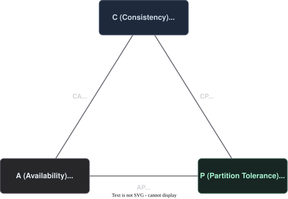

# 01-注册中心

## 概念
### 注册中心

- `注册中心`：**存储并管理**服务提供者提供的配置信息
- `服务提供者`：**提供**相关的配置内容
- `服务消费者`：从注册中心**获取**服务提供者提供
### CAP

- `C(Consistency)`: 一致性，它分为强一致性和弱一致性
	- `强一致性`：**任何时候**，同一个请求，**请求到的数据都是一样的**
	- `弱一致性`：**随着时间的推移**，同一个请求最终的请求结果是一样的
	> 以 `MySQL` 为例，`MySQL` 可以分为主库和从库，在修改数据的时候，需要有一定时间来主从同步。
	> - 如果是强一致性，那就**必须等待同步**完后才能访问
	> - 如果是弱一致性，那么**不需要等待同步**，但是可能会出现数据不一致的问题
- `A(Availability)`: 可用性，无论请求的结果是否正确，请求是否会有响应。一般它是和一致性是互斥的，两个只能选一个。
- `P(Partition Tolerance)`: 分区容错性，一个节点挂了，其他的节点能不能顶上，使得**整个系统的访问没有出现太大的问题**。在分布式架构下，这个是必须的

> **上诉的内容是在分布式架构下的说法，如果是单机架构，那就不一样的**