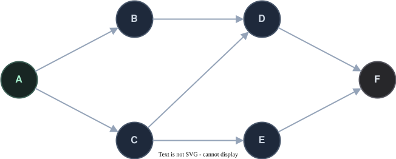
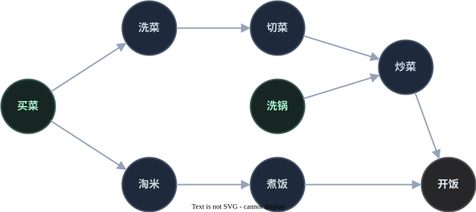

# 18-BFS-拓扑排序

## 概念
### 有向无环图

类似这个图中所示的，就是有向无环图（有方向，但是没有成环的图）

这图中，每个节点有**入度和出度**这两个属性
- `入度`：表示这个节点有多少条路线**指向它**
- `出度`：表示这个节点有多少条路线**指向其他的节点**

就以 D 为例，它的入度就是 2, 出度就是 1

### 顶点活动图

顶点活动图是用**顶点表示活动，边表示活动的顺序**。以这个图来说，顶点就是 “买菜” 和 “洗锅”，它们两个的**入度都是为 0**

### 拓扑排序
拓扑排序就是用来**表示活动执行的先后顺序**。

还是以“顶点活动图”中的洗菜做饭为例
- 它的第一轮是可以洗菜，也可以是洗锅，因为**它们两个的入度都为 0**
- 买菜做完后，**洗菜和淘米就都空出来了**，因此第二轮可以是洗菜或者是淘米
- 以此类推，最终它们的**结果就是一个洗菜做饭这个活动的先后顺序**

由于图中可能会有环，如果有环，那么最终会剩余一部分不能添加到活动先后顺序中，**因此拓扑排序一个很重要的应用场景就是判断图中是否有环**

#### 实现拓扑排序
这个就比较简单，先遍历一次图，**把入度为 0 的节点添加到队列中**，然后遍历队列就可以了：
1. 获取队列中的节点，找到它出度的对象
2. 把出度那个对象的入度减 1
3. **判断一下那个对象入度是否为 0, 如果为 0, 那么添加到队列中**
4. 反复循环，直到队列中没有节点为止或者图中没有节点为止


## 题目

在做题之前要思考，如何创建图呢？方法有两个，**嵌套列表或者使用哈希表**
- `嵌套列表`：**只适用于 `key` 是整数的情况**，它的结构类似是 `List<List<Integer>>` 外层列表存储 `key`，内层列表存储 `key` 对应出度的节点
- `哈希表`：这个是一个**比较万能的方式**，哈希表中的 `key` 是用来存储根结点，`value` 是存储根结点对应的那些子节点

### [LC207. 课程表](https://leetcode.cn/problems/course-schedule/)

思路很简单：
1. 创建各个节点的映射关系，**其中 `in` 是用来存储对应节点的入度数量**
2. 遍历一次入度数组，**把入度为 `0` 的节点添加到队列中**
3. 遍历队列
	1. **通过哈希表/嵌套数组**获取到存储子节点的集合，把集合中的所有子节点的入度数量减一
	2. 判断一下子节点入度数量是否为 0, **如果为 0 那么就要把这个子节点添加到队列中**
	3. 终止条件为**队列为空**
4. 再重新遍历一次入度数组 in，只要有一个值不为 0, 说明它是有环

```Java
public boolean canFinish(int n, int[][] p) {
	// 使用 hash 表来存储，key 是节点，val 表示它出度的对象
	HashMap<Integer, List<Integer>> hash = new HashMap<>();
	int[] in = new int[n]; // i 节点对应入度的数量

	for (int i = 0; i < p.length; i++) {
		int a = p[i][0], b = p[i][1]; // b -> a a 依赖 b
		if (!hash.containsKey(b)) {
			hash.put(b, new ArrayList<Integer>());
		}
		hash.get(b).add(a);
		in[a]++;
	}

	Set<Integer> keys = hash.keySet();
	Queue<Integer> queue = new LinkedList<>();
	for (int key : keys) {
		if (in[key] == 0) queue.add(key); // 说明 key 这个节点没有入度
	}
	
	while (!queue.isEmpty() && !keys.isEmpty()) {
		Integer key = queue.poll();
		List<Integer> list = hash.getOrDefault(key, List.of());
		for (int x : list) {
			if (--in[x] == 0) queue.add(x);
		}
		keys.remove(key);
	}
	return keys.isEmpty();
}
```