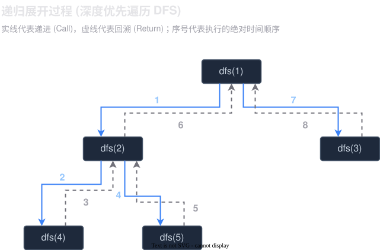

# 01-递归
## 题目
### [面试题 08.06. 汉诺塔问题](https://leetcode.cn/problems/hanota-lcci/)
- n 为 1 的情况下，直接把 A 上的元素移动到 B 就可以了（结束条件）
- 其他情况：
	1. 先把**上面的那部分**利用 C 过渡区，把元素移动到 B
	2. 然后在把 A 的**底层元素**移动到 C
	3. 最后利用 A 这个过渡区，**把 B 上的元素**移动到 C

```Java
public void hanota(List<Integer> A, List<Integer> B, List<Integer> C) {
	hanota(A, B, C, A.size());
}

// A 是起始地，B 过渡区， C 是目的地
private void hanota(List<Integer> A, List<Integer> B, List<Integer> C, int n) {
	if (n == 0) return;
	if (n == 1) {
		C.add(A.remove(A.size() - 1));
		return;
	}
	// 把 A 上面的那些利用 C 元素放入 B, 
	hanota(A, C, B, n - 1);
	// 把 A 的底层放入 C
	C.add(A.remove(A.size() - 1));
	// B 利用 A 放入 C
	hanota(B, A, C, n - 1);
}
```

### [LC21. 合并两个有序链表](https://leetcode.cn/problems/merge-two-sorted-lists/)

思考：
- 子问题：**合并两个有序列表，并且返回最小元素的结点**。
- 截止条件：当其中一个列表为空的时候，就可以直接返回另一个列表

```Java
public ListNode mergeTwoLists(ListNode list1, ListNode list2) {
	if (list1 == null) return list2;
	if (list2 == null) return list1;
	// 字问题：合并两个有序列表 返回的是最小元素的头结点
	ListNode min = null;
	if (list1.val < list2.val) {
		min = list1;
		list1 = list1.next;
	} else {
		min = list2;
		list2 = list2.next;
	}
	
	min.next = mergeTwoLists(list1, list2);
	return min;
}
```

当然也可以换一个思路：
- 子问题：**找到较小的那一个节点，把这个节点添加到 `result` 后，然后这个节点往下移动一位，`result` 也要往下移动一位**
- 截止条件：当其中一个列表为 null 的时候，就可以返回了

```Java
public ListNode mergeTwoLists(ListNode list1, ListNode list2) {
	ListNode result = new ListNode(-1);
	mergeTwoLists(list1, list2, result);

	return result.next;
}

public void mergeTwoLists(ListNode list1, ListNode list2, ListNode result) {
	// 截止条件
	if (list1 == null) {
		result.next = list2;
		return;
	}
	if (list2 == null) {
		result.next = list1;
		return;
	}

	// 子问题
	if (list1.val < list2.val) {
		result.next = list1;
		list1 = list1.next;
	} else {
		result.next = list2;
		list2 = list2.next;
	}
	result = result.next; // result 不会断开，因为第一个引用的地方（第一次调用这个方法）是没有释放

	mergeTwoLists(list1, list2, result); // Java 中貌似不对尾递归经行优化
}
```

#### 思考
众所周知，递归和迭代是可以相互转换的，那么就出现了一个问题：什么时候使用迭代比较方便，什么时候使用递归比较方便？

||

首先，我们需要明白一件事情，**递归本质是一个深度优先遍历**，它是会执行到最底部才会返回，**遍历的过程就很像一颗树，而树的度的多少，决定代码从递归变为迭代方便程度**

如果度为 1，那么把递归变为迭代就比较方便，因为不需要存储上一个节点的信息，但是一旦它的度超过了 1, 那么就比较麻烦了，**因为需要引入栈来存储之前的节点的信息**
||

### [LC206. 反转链表](https://leetcode.cn/problems/reverse-linked-list/)
**可以把链表看为一颗度为 1 的特殊的树。**

子问题：获取到它的最后的节点，然后翻转一下，不过注意，**这个是后序遍历**

```Java
public ListNode reverseList(ListNode head) {
	if (head == null || head.next == null) return head;

	ListNode result = reverseList(head.next);
	// 子问题：采用后序遍历，获取到头结点，然后逆序
	head.next.next = head;
	head.next = null;
	return result;
}
```

### [LC50. Pow(x, n)](https://leetcode.cn/problems/powx-n/)
这里是使用快速幂来求：**每一次求的时候把 n 对半分**，求出对半分的结果后，把那两个相乘一次就可以了。

细节：需要考虑 n 为负数的情况
> 在 Java 中 n 为 $-2^{31}$ 是不需要变为 long 型

```Java
public double myPow(double x, int n) {
	return n >= 0 ? pow(x, n) : 1 / pow(x, -n);
}

private double pow(double x, long n) {
	if (n == 0) return 1;
	double tmp = pow(x, n / 2);
	return tmp * tmp * (n % 2 == 0 ? 1 : x);
}
```


